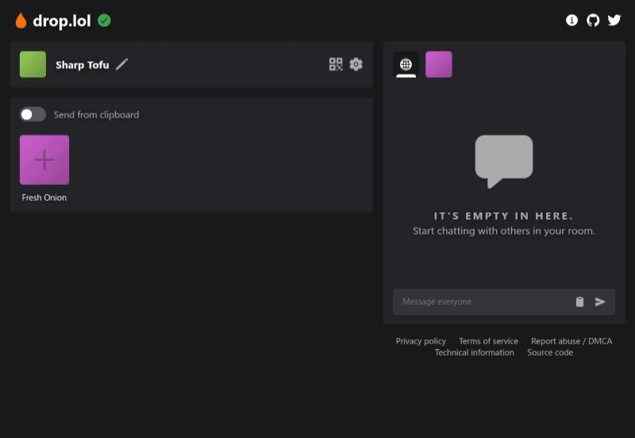

# FileDrop

Available at: https://drop.shiroya.in/

Easy end-to-end encrypted, peer-to-peer file transfer.

Maintained by: Vraj Shiroya  
Email: vraj@shiroya.in  
Website: https://drop.shiroya.in/  
GitHub: https://github.com/VG31OP

**Features:**

- Fully end-to-end encrypted, including metadata and chat.
- Peer-to-peer wherever possible (using WebRTC).
- Simple chat function with copy and paste.
- Progressive Web App support.
- Modern, glass-inspired user interface.

    

## Docs

- [Usage/self-hosting](./docs/usage.md)
- [FAQ](./docs/faq.md)
- [HTTPS setup](./docs/https/index.md)
